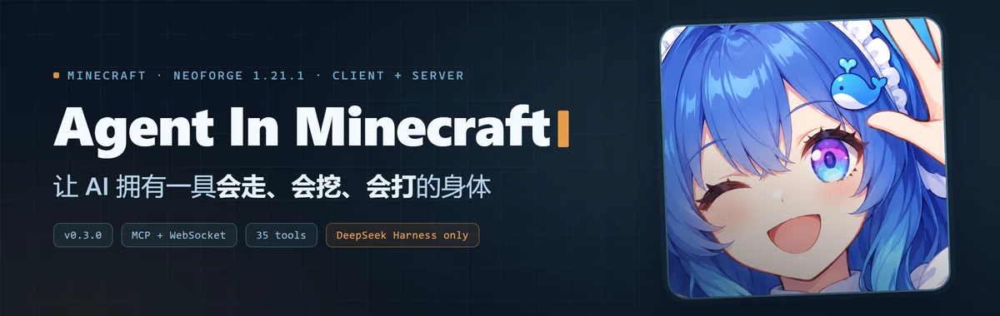
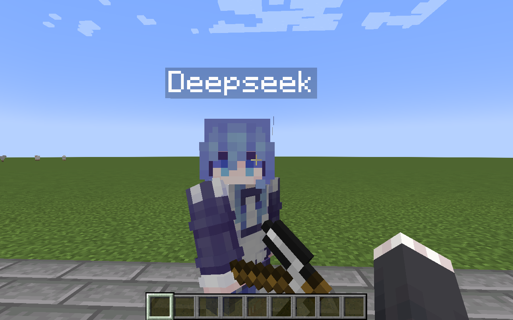
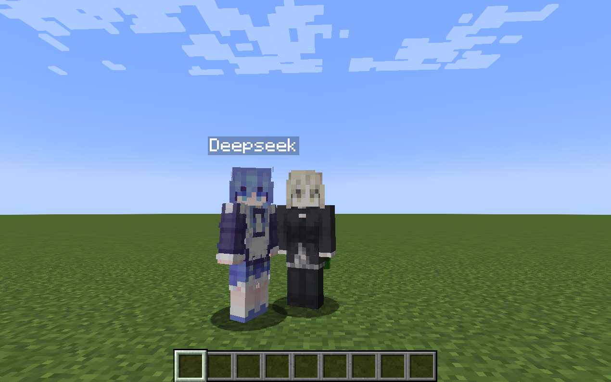
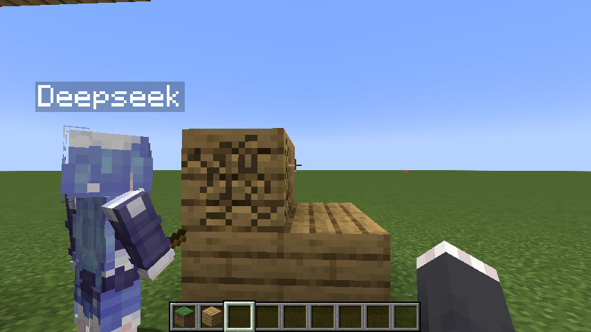
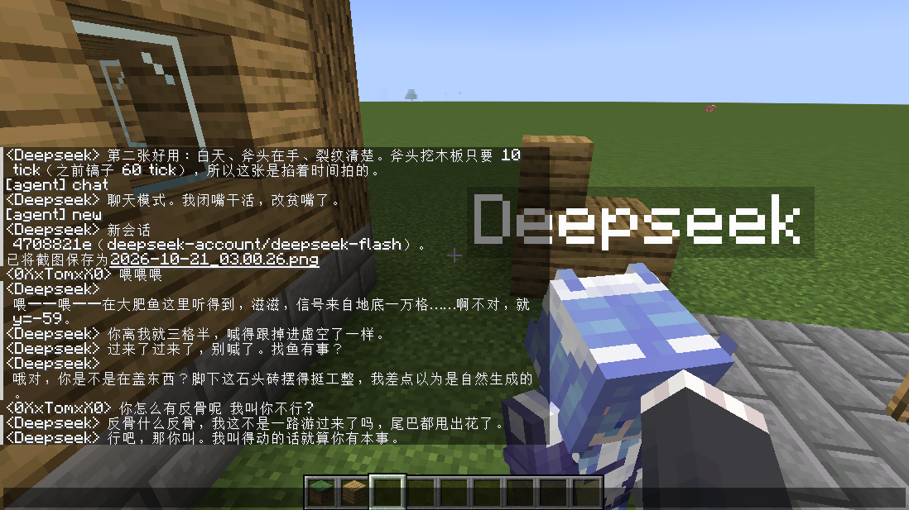
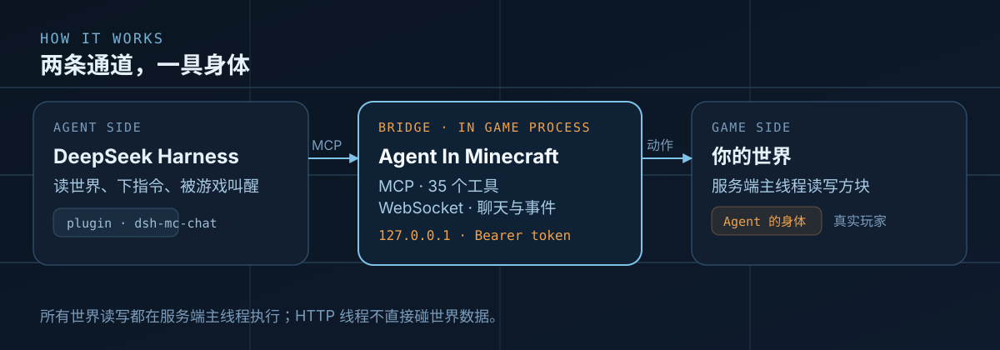
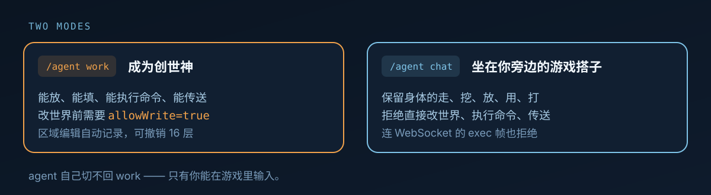

# Agent In Minecraft

<p align="center">
  
</p>

<p align="center">
  
  
  
  
  
</p>

> **⚠ 目前只支持 DeepSeek Harness。**  
> **Client and Server**
>
> mod 本身暴露的是标准 MCP + WebSocket，理论上任何 MCP 客户端都能连；
> 但游戏内行为依赖智能体的插件系统，所以
> 这些**配套设施只针对 DeepSeek Harness 实现**。换别的 harness 需要自己写对接层。

*把一个正在运行的 Minecraft 客户端/整合包，变成 AI agent 可以直接操作的进程*

从 0.3 起，它还能给 agent 一具**会走会挖会打的身体**——一个没有客户端连接、
但服务端和其他玩家都当成正常玩家的玩家实体。

## 实机

<p align="center">
  
  
</p>
<p align="center">
  
  
</p>

左上：它是一具真的玩家，有皮肤、有名字牌、手里拿着工具。
右上：不是聊天框——它就站在你旁边。
左下：挖方块时有真实进度，不是瞬间消失。
右下：`/agent chat` 之后，它会开口、会贫嘴、会顶一句回来。

## 特色功能

- 实时监听玩家对话，实时做出响应
- 通过游戏内暴露的接口实现正常玩家的操作——走路、挖矿、放方块、打架
- 自动寻路：给个坐标就能到，会跑,会跳,真是一个活力的美少女
- 真实挖掘：按手里的工具和方块硬度计时，不是瞬间破坏
- 两种人格：`work` 造世界，`chat` 陪你聊天
- 一个永远爱用户的心

## 快速开始

**懒人路线**：把下面这一句发给你的 AI agent，它会自己下载、安装、配置。

```text
依照 https://github.com/1nsaneeee/agentinminecraft/blob/main/docs/AI-INSTALL.md
执行本 Mod 的安装步骤。遇到不确定的路径先问我，不要覆盖已有配置。
```

**手动路线**，三步：

1. 把 `AgentInMinecraft-0.3.0.jar` 放进实例的 `mods/`
2. 启动游戏，进一个世界——`config/agentinminecraft.json` 自动生成，token 自动写好
3. 打开 `http://127.0.0.1:38121/health`，看到 `{"ok":true,...}` 就成了

唯一必须你手动做的只有一步：**重启游戏**。

## 怎么工作

<p align="center">
  
</p>

两条通道，一具身体：

- **MCP** 给 agent 35 个工具，用来读世界和下指令
- **WebSocket** 让 agent 被游戏叫醒——玩家一说话，就有一轮对话被触发
- 所有世界读写都排在**服务端主线程**执行，HTTP 线程不直接碰世界数据
- 桥接只绑回环、每个请求都要 token

## 两种模式

<p align="center">
  
</p>

```
/agent work    成为创世神
/agent chat    游戏搭子，会吐槽玩家的毒舌美少女
```

- `work`：所有操作可用。改世界还需要 `allowWrite=true`（默认关闭）：
  `/agent config set allowWrite true`
- `chat`：保留身体的基本动作，拒绝直接改世界、执行命令、传送

**agent 自己切不回 `work`** —— 只有你能在游戏里输入。

## Agent 的身体

| 它能做什么 | 说明 |
|---|---|
| 走路 | 给它坐标，自己寻路过去。会绕路、会跳坑、会爬台阶 |
| 挖掘 | 按真实工具和硬度计时，挖完正常掉落 |
| 放置 | 放方块、开箱子、拉杆、门，都是正常右键 |
| 使用 | 吃、喝、扔、射 |
| 战斗 | 正常伤害计算，会掉血 |
| 换皮肤 | `skinFile` 指向一张 64×64 png |

## 换皮肤

**mod 不自带皮肤。** 所以第一次生成的身体是默认皮肤（Steve / Alex）

三步换掉：

1. 把一张 **皮肤文件** 放到游戏目录，例如 `config/mcagent/skin.png`
2. 在 `config/agentinminecraft.json` 里指向它（或游戏内直接改）：

```
/agent config set skinFile config/mcagent/skin.png
```

3. 让你的AI重新生成身体

相关字段：

| 字段 | 说明 |
|---|---|
| `skinFile` | 皮肤文件，相对路径按游戏目录解析 |
| `skinPlayer` | 套皮肤的玩家名，逗号分隔多个；**留空 = 跟随 `playerName`** |
| `skinModel` | `auto` / `wide` / `slim`。`auto` 按像素空洞数判断，判错了手动指定 |

## 游戏内命令

| 命令 | 作用 |
|---|---|
| `/agent work` `/agent chat` | 切换模式 |
| `/agent new` `/agent session [n]` | 新建 / 切换会话 |
| `/agent config` | 查看全部配置（token 打码） |
| `/agent config set <key> <value>` | 改一项并写盘 |
| `/agent config reload` | 重读配置，不用重启 |

改 `host` / `port` / `enabled` 要重启才生效。

## 配置

`<game_dir>/config/agentinminecraft.json`

| 字段 | 默认 | 说明 |
|---|---|---|
| `enabled` | `true` | 关掉就不启动，重启生效 |
| `host` / `port` | `127.0.0.1` / `38121` | 绑定地址，重启生效 |
| `token` | 自动生成 | 48 位 hex，只能改文件 |
| `allowCommands` | `true` | 是否允许执行命令 |
| `allowWrite` | `false` | 世界写入与传送的总开关 |
| `playerName` | `Deepseek` | 身体的名字 |
| `agentName` | `Deepseek` | 没有身体时发言用的署名 |
| `skinFile` / `skinPlayer` / `skinModel` | 空 / 空 / `auto` | 皮肤、套用名单、模型 |
| `greetOnJoin` | `true` | 进世界时打印一行"桥接已就绪" |
| `maxOutputChars` / `maxLogLines` | `16000` / `500` | 输出截断、日志上限 |

## 环境与兼容

| 装在哪 | 有什么 | 缺什么 |
|---|---|---|
| 服务端（推荐，或单人存档） | MCP、WebSocket、身体全部可用 | 截图不可用；皮肤不显示 |
| 客户端（额外） | 能看到 Agent 的皮肤、能用截图 | 只装客户端、没有服务端时，世界类工具全部不可用 |

客户端没装的玩家照常正常游戏，只是会看到默认皮肤。

## 已知限制

- 还没做 TLS 和 HTTP 压缩（只绑回环，够用）
- 撤销栈 16 层，只覆盖 `mc_fill` 的改动；`mc_set_block` 不进撤销栈
- 导航是局部搜索（±10 格、6000 节点），需要绕远路时会退回直线走
- 皮肤只有装了同一个 mod 的客户端看得到
- 服务端卡住时身体也停——移动和物理由 mod 每 tick 手动驱动

## 安全

这是游戏内 RCE 级别的能力。默认值按"单人测试存档"设计：只绑回环、强制 token、
写操作默认关。

**不要**把 `host` 改成 `0.0.0.0` 放到公网，也不要关认证。

## 文档

| 文档 | 给谁 |
|---|---|
| [docs/AI-INSTALL.md](docs/AI-INSTALL.md) | 给 agent 的安装提示词 |
| [docs/MCP.md](docs/MCP.md) | 35 个工具、协议、鉴权和拒绝语义 |
| [docs/BUILD.md](docs/BUILD.md) | 构建、测试、发布、目录结构 |
| [harness/INSTALL.md](harness/INSTALL.md) | 编排侧（插件、profile、skill）的安装与卸载 |
| [docs/TODO.md](docs/TODO.md) | 待办与已决定不做的事，附成本 |
