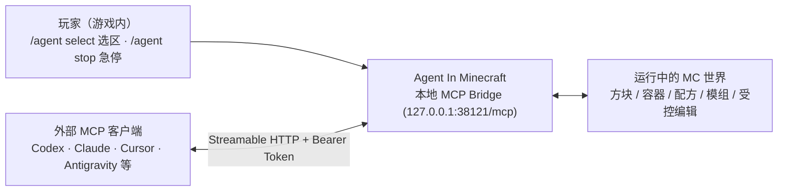

# Agent In Minecraft

> 在 Minecraft 里选中现场，在你自己的 AI Agent 里提问、排障与受控编辑。

**Agent In Minecraft** 是一个面向 **Minecraft 1.21.1（NeoForge 21.1.x）** 的工程桥接模组，将运行中的单人世界或独立服务器通过标准 **MCP（Streamable HTTP）** 暴露给外部 AI 客户端。对话、模型与推理完全由你自己的外部 Agent 负责，模组只做三件事：**读取真实世界现场、提供整合包运行时知识、执行可核验且可撤销的受控操作**。

**当前版本**：`0.5.0-rc.3`（Pre-release） · **运行环境**：Minecraft Java 1.21.1 · NeoForge 21.1.x · Java 21 · 单人 & 专服已实测 · MIT License  
[下载预发布包](https://github.com/1nsaneeee/agentinminecraft/releases/tag/v0.5.0-rc.3) · [安装与客户端接入](docs/AI-INSTALL.md) · [MCP 工具与权限说明](docs/MCP.md) · [从 0.3.x 迁移](docs/releases/0.5.0-rc.3.md#从-03x-升级) · [更新日志](CHANGELOG.md)

---

## 它是怎么工作的



* **不绑定任何特定模型或聊天框架**：任何支持标准 **MCP Streamable HTTP** 的客户端都能直接接入，不再需要旧版的 DeepSeek 专用适配器或游戏内聊天桥。
* **以玩家视角为中心**：在游戏里对准方块、实体或用两点框选区域后，直接向外部 Agent 提问——不用手抄坐标，也不用一个个报方块 ID。

---

## 真实场景：「帮我看看这排炉子怎么了」

在一排四座熔炉前，玩家对准两端执行 `/agent select corner a` 与 `/agent select corner b`，随后在外部 Agent 里只问了一句 **「帮我看看这排炉子怎么了」**（不给坐标、不给故障提示；旁边更近处还有一排健康运转的炉子干扰）。

三个全新会话的实机盲测全部只读现场、零改动方块，并分别定位出三种不同故障：

| 盲测轮次 | 定位结论 | Agent 读到的现场证据 |
| --- | --- | --- |
| 第 1 轮 | 2 号炉缺燃料 | 输入槽 64 个铁矿石，燃料槽为空，燃烧时间与烧制进度均为 `0`。 |
| 第 2 轮 | 4 号炉输出堵塞 | 铁矿与煤炭充足，输出槽已满 64 个铁锭，跨 tick 复查仍未推进。 |
| 第 3 轮 | 1 号炉上游被锁 | 炉内有煤无矿；向上追查到顶部漏斗囤着 64 个铁矿且 `enabled=false`，进而定位到旁边锁死漏斗的红石块。 |

> 完整实机读数、调用摘要与模型答错的额外建议记录见 [0.5.0-rc.3 实机验收](docs/releases/0.5.0-rc.3.md#实机验收)。

---

## 3 分钟快速接入

### 1. 安装模组
关闭目标游戏实例或独立服务器，从 [Release 页面](https://github.com/1nsaneeee/agentinminecraft/releases/tag/v0.5.0-rc.3) 下载预发布 ZIP 或独立 JAR：
* **手动安装**：将 JAR 放入游戏目录的 `mods/`（升级时务必先移走旧版 `AgentInMinecraft-*.jar`，只保留一份）。
* **脚本安装（PowerShell 7）**：解压完整 ZIP 后预览并应用安装（自动校验清单并备份旧 JAR）：
  ```powershell
  ./install.ps1 -InstancePath 'D:/Games/MyInstance/minecraft'
  ./install.ps1 -InstancePath 'D:/Games/MyInstance/minecraft' -Apply
  ```

### 2. 配置外部 MCP 客户端
启动游戏并进入世界，从实例目录下的 `config/agentinminecraft.json` 读取 `token`（默认监听 `http://127.0.0.1:38121/mcp`）。

* **支持环境变量的 TOML 客户端（如 Codex）**：
  ```powershell
  $cfg = Get-Content -LiteralPath 'D:/Games/MyInstance/minecraft/config/agentinminecraft.json' -Raw | ConvertFrom-Json
  $env:MCAGENT_TOKEN = $cfg.token
  ```
  ```toml
  [mcp_servers.minecraft]
  url = "http://127.0.0.1:38121/mcp"
  bearer_token_env_var = "MCAGENT_TOKEN"
  ```
* **标准 JSON 客户端（Streamable HTTP）**：
  ```json
  {
    "mcpServers": {
      "minecraft": {
        "url": "http://127.0.0.1:38121/mcp",
        "headers": {
          "Authorization": "Bearer <你的 config/agentinminecraft.json token>"
        }
      }
    }
  }
  ```

### 3. 验证连通
让 Agent 调用 `mc_status`：看到 `running=true`、当前世界信息与你的玩家 UUID 即表示已接通。多人环境下提问时顺手报一下自己的游戏名即可。详见 [完整接入步骤](docs/AI-INSTALL.md)。

---

## 核心能力一览

| 能力域 | 代表 MCP 工具 | 典型用途 |
| --- | --- | --- |
| **世界与选区观测** | `mc_status`、`mc_selection`、`mc_block`、`mc_blocks`、`mc_block_entity`、`mc_entities`、`mc_inventory`、`mc_screenshot`、`mc_logs` | 读取选中机器的方块状态、NBT、容器物品、实体、画面截图与运行日志。 |
| **跨 Tick 动态核验** | `mc_observe`、`mc_observe_wait`、`mc_watch`、`mc_watch_list`、`mc_wait` | 跨越多个游戏 tick 对比机器进度、能量/燃烧变化，确认产线是否真的在运转。 |
| **整合包运行时知识** | `mc_knowledge`、`mc_recipe`、`mc_tags`、`mc_item_inspect`、`mc_command_inspect`、`mc_quests`、`mc_quest` | 核对当前实例实际安装的模组版本、生效配方、物品标签、物品组件、命令语法与 FTB Quests 任务（自定义机器细节取决于对应模组暴露的数据）。 |
| **受控编辑与分批撤销** | `mc_edit_preview`、`mc_edit_preview_selection`、`mc_edit_apply`、`mc_edit_start`、`mc_edit_jobs`、`mc_undo_records`、`mc_undo_start`、`mc_undo` | 先预览拿到 `planId` / `planRevision`，授权后应用并读回核验；支持大区域分批作业、冲突保护与可追踪撤销。 |
| **控制与工程身体（可选）** | `mc_control_status`、`mc_control_stop`、`mc_command`、`mc_player_*` | 状态与急停控制；在需要实体角色移动、交互或施工测试时，仍保留按需调用的 FakePlayer 工具集。 |

> 运行中的精确工具清单与参数结构，可由客户端在初始化会话后通过标准 MCP `tools/list` 自动发现。详见 [MCP 接入与世界操作](docs/MCP.md)。

---

## 游戏内命令速查

| 命令 | 说明 |
| --- | --- |
| `/agent select block` / `entity` | 选中准星指向的方块或实体（需 2 级管理权限）。 |
| `/agent select corner a` / `corner b` | 标记选区对角点，框选整排机器或建筑区域。 |
| `/agent select show` / `clear` | 查看或清除个人选区（退出或切换维度自动清除）。 |
| `/agent stop` | **立即急停**：中止正在进行的编辑、观察与身体动作，但保持只读查询可用。 |
| `/agent resume` | 仅限真人玩家在游戏内手动恢复新操作权限（不会自动重放已停旧任务）。 |
| `/agent edit stop` / `discard-undo <id> confirm` | 停止编辑作业，或由真人确认丢弃指定撤销记录。 |
| `/agent config` / `set <key> <value>` / `reload` | 查看、修改并原子重载配置（支持热更新监听与凭据）。 |

---

## 安全与权限设计

* **默认仅限本机 + Token 鉴权**：默认绑定 `127.0.0.1:38121`，所有请求需携带 `Bearer` 凭据。
* **读与写、命令与受管编辑分离**：默认 `allowWrite=false`、`allowCommands=true`。注意 `mc_command` 可执行原版或模组指令，命令副作用**不会**自动进入受管编辑的撤销记录；只做排障时建议明确约定只读范围。
* **会话归属与自动失效**：支持多客户端并发只读；独占写权限绑定到单个 MCP 会话（空闲约 120 秒自动释放，分批编辑作业另有 15 秒 keepalive）；换世界、重载配置或执行 `/agent stop` 后，旧计划与旧会话立即失效。

---

## 从 0.3.x 升级

`0.5.0-rc.3` 是一次聚焦 **MCP 工程桥** 的破坏性重构：
* **已移除**：游戏内聊天唤醒、`/agent ask | new | session | chat` 对话命令、角色人格注入，以及旧版公开 `/ws` WebSocket 端点。
* **新方式**：直接在你常用的外部 MCP 客户端发起对话，游戏内专注选区与人工管控。详细迁移对照表见 [0.5.0-rc.3 迁移与发布说明](docs/releases/0.5.0-rc.3.md)。

---

## English Overview

**Agent In Minecraft** exposes a running **Minecraft 1.21.1 (NeoForge 21.1.x)** world to any external **MCP (Streamable HTTP)** client. Point at blocks, entities, or regions in-game (`/agent select ...`), then inspect live machine states, inventories, installed mods, active recipes, tags, and quests from your own AI agent—or run authorized, preview-first, undoable world edits with human `/agent stop` control.

* **Endpoint**: `http://127.0.0.1:38121/mcp` (Streamable HTTP + Bearer token from `config/agentinminecraft.json`)
* **Breaking change from 0.3.x**: Public `/ws`, in-game chat/session commands, and DeepSeek-specific adapters have been retired. Use `tools/list` after MCP `initialize` to discover all available tools.
* **Docs**: [Setup Guide](docs/AI-INSTALL.md) · [MCP Reference](docs/MCP.md) · [Release Notes & Evidence](docs/releases/0.5.0-rc.3.md) · [Build & Tests](docs/BUILD.md) · [Changelog](CHANGELOG.md)
